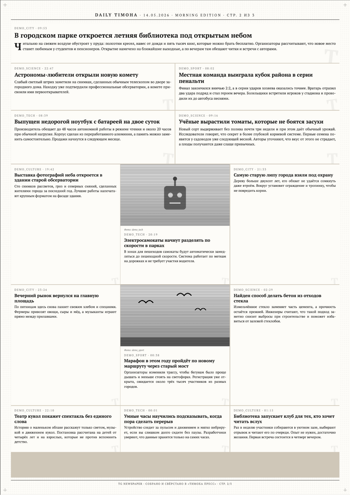
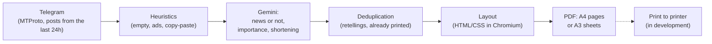

# 🗞️ TG Newspaper

**A morning newspaper from your Telegram channels: press a button, get an issue you can read over coffee and put down.**

[](https://github.com/tiltozavr2545/tg_newspaper/releases/latest)


### [⬇️ Download for macOS and Windows](https://github.com/tiltozavr2545/tg_newspaper/releases/latest)

<p align="center">
  
</p>

<sub>The demo issue is assembled from made-up news: real issues contain posts from your own channels, so they aren't in the repository.</sub>

## 📰 What this is

The Telegram feed never ends: you open it "for a minute" and vanish for an hour. TG Newspaper replaces morning scrolling with a **printed issue of fixed length**. The feed is endless — the newspaper isn't.

- 📥 Pulls posts from your channels for **the last 24 hours** from the moment you press the button. No schedule, no auto-start: an issue is assembled only when you press "Assemble newspaper" yourself.
- 🧹 Filters out "non-news" (ads, empty posts, media without a caption) and duplicates — when the same story is covered by several channels.
- ⚖️ A neural network rates how important each story is. The most important goes into the issue first, filler doesn't make it in, and long pieces are shortened so more fits.
- 🗞️ Lays out the issue: a tabloid-style **poster cover** (loud headlines and photos, no articles on it) plus **up to 6 pages of news**. Text is never cut off mid-sentence: whatever doesn't fit gets a short summary from the model instead. Emoji and channels' promotional taglines ("Follow us on MAX", "Subscribe") are stripped, and photos are printed only where dropping them would lose the point.
- 🎯 **Learns your interests**: a short onboarding on first launch and a survey after every issue ("rank these 5 posts by importance") tune the selection to you.
- 📄 Delivers the finished issue as a PDF: single A4 pages or merged A3 sheets.

Everything runs **on your own computer**: keys and data never go anywhere except Telegram and Gemini themselves.

<p align="center">
  
</p>

## ⚙️ How it works



Telegram is read via a regular user account (not a bot), because that's the only way to pull a channel's history for the past day in one shot. Details are at the end of the README, in the "For developers" section.

## 💾 Installation

You'll need a computer running macOS or Windows, and internet access.

### macOS

1. Open the [Releases](https://github.com/tiltozavr2545/tg_newspaper/releases/latest) page and download **`TG-Newspaper-<version>-mac.dmg`**.
2. Open the dmg and drag **TG Newspaper** into "Applications".
3. First launch. The app is **not code-signed**, so macOS will ask for confirmation:
   - right-click the app → **"Open"** → **"Open"**;
   - or launch it normally, then go to "System Settings" → "Privacy & Security" → **"Open Anyway"**.

### Windows

1. On the [Releases](https://github.com/tiltozavr2545/tg_newspaper/releases/latest) page, download **`TG-Newspaper-<version>-windows-setup.exe`** and run it. No admin rights needed; the app installs to `%LOCALAPPDATA%\Programs\TG Newspaper`, and a shortcut appears in the Start menu (a desktop shortcut is optional, via a checkbox in the installer).
2. If SmartScreen shows "Windows protected your PC" (the installer isn't signed) — click **"More info"** → **"Run anyway"**.

### First launch

On first launch the app sets up everything it needs by itself: the [uv](https://docs.astral.sh/uv/) package manager, Python, libraries, and the Chromium browser used for layout. This takes **2–3 minutes and requires internet**. While it's preparing, a waiting page is shown in the browser, which then automatically redirects to the console at `http://localhost:8420/`. The console is only reachable from your own computer.

Subsequent launches are fast. Clicking the icon again while the console is already running just opens another tab.

## 🧭 Setup

Until the project is configured, the console takes you straight to a **four-step setup wizard** — no need to edit files by hand. Any step can be redone later (the **"Settings"** link on the home page).

You'll need:

| What | Why | Where to get it |
|---|---|---|
| A separate Telegram account | to read channels | your own phone number |
| `api_id` and `api_hash` | access to the Telegram API | [my.telegram.org](https://my.telegram.org) |
| A Gemini key | the model selects and rates news | [Google AI Studio](https://aistudio.google.com/app/apikey) |
| A Cloudflare Worker | a proxy to Gemini (without it, Gemini doesn't respond from Russia) | a free [Cloudflare](https://dash.cloudflare.com) account |
| A list of channels | what to read | you decide |

### Step 1. Telegram API

> ⚠️ **Set up a separate Telegram account for this project — not your personal one.** The app logs into Telegram as a human user, and the session file it creates is the key to the whole account (not a token with limited rights). If it ever leaks, only the separate account is affected, not your main one.

1. Go to [my.telegram.org](https://my.telegram.org) and log in with the phone number of **this separate account** (the code arrives via Telegram).
2. Choose **"API development tools"** and create an app: the name and short name can be anything.
3. Copy the **`api_id`** (a number) and **`api_hash`** (a long string).
4. In the wizard, paste them into the **"1. Telegram API"** card and click "Save". You can leave the "Session file name" field as is.

No bot token is needed: the app reads channels as a regular user.

### Step 2. Log in to Telegram

In the **"2. Log in to Telegram"** card:

1. Enter the project account's phone number (format `+79991234567`) → "Send code".
2. Enter the code Telegram sends to the app (usually not via SMS) → "Log in".
3. If two-factor auth is enabled, you'll be asked for the password next.

Once it succeeds, the card will show "Logged in: account name". Entered the wrong number? Use the "Start over" button.

### Step 3. Gemini and the Cloudflare proxy

News selection and rating use the **Gemini** model (the free tier is enough). It doesn't respond directly from Russia: `User location is not supported`. That's why **a proxy through your own Cloudflare Worker is required**: Google sees Cloudflare's address instead of yours, and requests go through. The wizard won't accept this step until the proxy address is filled in.

**3.1. Gemini key.** Go to [Google AI Studio](https://aistudio.google.com/app/apikey), create an API key, and copy it.

**3.2. Create a Worker** (a one-time step that takes a few minutes):

1. Go to <https://dash.cloudflare.com> (sign up for free if needed) → **Workers & Pages** → **Create** → **Worker**.
2. Give it a name, e.g. `tg-newspaper-gemini`, and click **Deploy**.
3. Click **Edit code**, delete everything there, and paste in the contents of this repository's [`cloudflare-worker.js`](cloudflare-worker.js). It's a small script that forwards requests to the Gemini API; it only lets Gemini paths through. Leave the `PROXY_SECRET` line empty.
4. Click **Deploy** again.
5. Copy the worker's address, which looks like `https://tg-newspaper-gemini.YOUR-ACCOUNT.workers.dev`.

**3.3. Fill in the "3. Gemini" card in the wizard:**

| Field | What to enter |
|---|---|
| `GEMINI_API_KEY` | the key from AI Studio |
| Model | defaults to `gemini-3.5-flash-lite`, fine to leave as is |
| `GEMINI_BASE_URL` (required) | your worker's address. Only `https://`; a trailing slash is trimmed automatically |

Click **"Save and verify"**: the app will make one cheap request to Gemini through your proxy and report what's wrong, if anything (key rejected, model not found, proxy unreachable, region unsupported).

### Step 4. Channels

In the **"4. Channels"** card, enter source channels **one per line**. Any of these formats work:

```
durov
@telegram
https://t.me/example_channel
```

The app will store clean channel names. Click **"Save and check access"**: each channel is checked through your session, and next to it you'll see "accessible: channel name" or the reason it failed (no such channel, the channel is private, it's a user or a bot).

**Sections.** Channels can be grouped into sections — in the issue, each section prints as its own block with a heading, in the order they appear in the list (channels with no section, if any sections are defined at all, go last under a "Misc" section). A line starting with `#` names a section (it can be several words); channels listed under it belong to that section. Channels before the first heading stay without a section:

```
# News
rotondamedia
mudak

# Bloggers
lvcai
```

### Step 5 (optional). YouTube channels

The **"5. YouTube channels"** card adds a "New videos" block at the end of the issue. Enter channels one per line: `@handle`, a link like `https://www.youtube.com/@handle` or `.../channel/UC...`, or a bare `UC...` id. On save, the app checks the channels over the network and fills in their names; if a line can't be recognized, nothing is saved and the errors are shown under the form. Shorts are excluded from the block. An empty list means no videos; this step isn't required for the wizard to proceed.

On following channels: it's convenient to have the project account **follow all source channels** (that's how the project is designed to work). The wizard checks public channels by name. Private channels only work if the account is already a member, and invite links like `t.me/+...` aren't supported: a public `username` is required.

### Onboarding

Once all four steps are green, the wizard offers **onboarding** (`/onboarding`) — a couple of minutes about you:

- two text fields: "What interests you" and "What doesn't" (topics, channels, formats, free text);
- up to three rounds of 5 real posts from your channels: rank them by importance, where 1 is the most important. There won't be any rounds until the database has past runs; until then, only the text fields are saved.

Until onboarding is complete, the "Assemble" button won't start a run. If you'd rather skip it, there's a "Skip" button — the newspaper will just run without personal tuning.

## 🖨️ How to use it

1. Open **TG Newspaper** (the icon in "Applications" or the Start menu). The console opens in your browser.
2. Click **"🗞️ Assemble newspaper"**. The app will pull posts from the last 24 hours, filter them, remove duplicates, and lay out the issue. This takes **a few minutes** (reading Telegram, calling Gemini, layout), and the page refreshes on its own.
3. The **run page** opens: a "Issue" block at the top, and below it a table of all posts marked "included" or "filtered out", with the reason.

In the "Issue" block:

- **page previews**: click an image to open the page full-size;
- **"Download PDF — N A4 pages"**: each page on its own A4 (landscape) sheet, ready for a regular printer;
- **"Download PDF — N A3 sheets"**: the same content, but two pages per A3 sheet (297 × 420 mm). Pages sit flush against each other with no seam, so the sheet reads as a single page. The cover is laid out the same way: one sheet made of two pages;
- **"Re-assemble issue"**: re-render the same run from scratch (useful if, say, something went wrong during layout — the underlying selection is kept).

**Edition by time of day.** You can assemble the newspaper several times a day: the cover and page headers show a Morning, Afternoon, Evening, or Night edition — based on your computer's clock at the moment you pressed the button. The issue date is also taken from your computer's clock, and the PDF filename includes the date and edition, e.g. `tg-newspaper-2026-10-14-morning-a4.pdf`, so issues from the same day don't overwrite each other.

How many pages an issue has: the cover (2 A4 pages = 1 A3 sheet) plus up to 6 news pages. If there isn't much news, the issue will be shorter. But if fewer than 10 news items made it through in a day, no issue is assembled: the run page and the terminal will say so ("Not enough news today: N (need at least 10) — no issue assembled").

The PDF is generated on first download (a few seconds) and served from cache after that.

**Survey after each issue.** The home page will show a "Rate the last issue" block. The survey has 5 posts (some were in the issue, some didn't fit): rank them by importance, 1 being most important. There are deliberately no hints — the model's scores and the "was in the issue" flag are only shown after you submit, on the comparison page. The more surveys you complete, the better the newspaper gets at matching your taste; the home page shows whether the match with your ranking is improving.

**Shutting down.** The **"Shut down console"** button at the bottom of the home page (the app version is shown next to it). Start it again with the same icon.

## 🔒 Where data is stored, and security

Data lives **outside the app**:

| OS | Folder |
|---|---|
| macOS | `~/Library/Application Support/TG Newspaper` |
| Windows | `%LOCALAPPDATA%\TG Newspaper` |

Inside:

| What | Where |
|---|---|
| Keys (`TG_API_HASH`, `GEMINI_API_KEY`, proxy address) | `.env` |
| Telegram session | file `tg_newspaper.session` (the name can be changed in step 1) |
| Channel list | `config/channels.yaml` |
| Database (posts, runs, reader profile, feedback) | `data/` |
| Finished issues: pages and PDFs | `data/issues/run_<run id>/` |
| Logs | `data/console.log`, `data/setup.log` |

On security:

- Keys are stored **only on your own computer**. The `.env` and session files are created with owner-only permissions (0600).
- The UI shows secrets masked (`••••1234`) and never logs them. Leaving a secret field empty when reconfiguring means "don't change it".
- Keys never end up in the repository or the installer: they only ever exist in your own data folder.
- The app only talks to Telegram and Gemini (through your proxy) over the network. The console only listens on `localhost`.

**Removal.** Uninstalling (dragging the app to the Trash on macOS, "Apps" on Windows) **doesn't touch your data**: settings, the session, and past issues remain. To erase everything, delete the data folder from the table above by hand. You can also end the session entirely from Telegram itself: "Settings" → "Devices".

## 🔄 Updating

Download the new version from the [Releases](https://github.com/tiltozavr2545/tg_newspaper/releases/latest) page and install it over the old one (on macOS, replace the app in "Applications"). **Your data is preserved**: it lives in a separate folder. After updating, the first launch may prepare the environment again, which takes a couple of minutes.

## 🛟 If something doesn't work

| What happened | What to do |
|---|---|
| macOS: "app is damaged" / won't open | The app isn't signed. Right-click → "Open", or "System Settings" → "Privacy & Security" → "Open Anyway". |
| Windows: SmartScreen | "More info" → "Run anyway". |
| The waiting page hangs for more than 5 minutes | Check your internet connection. If setup failed, the app shows an error window; details are in `data/setup.log` in the data folder. |
| "Console didn't start within 90 seconds" | Open `data/console.log` (on Windows, also `data/console.err.log`) in the data folder: the reason is there. |
| The console won't open at `http://localhost:8420/` | Port **8420** is taken by another program, or the console failed to start. Close whatever's using the port and open TG Newspaper again; log: `data/console.log`. |
| `User location is not supported` | Gemini sees your region as unsupported: make sure `GEMINI_BASE_URL` points to your worker and that the worker is deployed. To check manually, open `https://<your-worker>.workers.dev/v1beta/models?key=YOUR_KEY`: it should return a list of models, not a region error. |
| "Gemini rejected the key" | Create a new key in Google AI Studio. |
| "Model not found" | Check the model name and the proxy address: the worker only forwards paths starting with `/v1`. |
| A channel in the wizard shows "not found" | Check the `username`; for private channels, the project account must already be a member. |
| The "Assemble newspaper" button goes to onboarding | Complete it, or click "Skip". |
| Fonts look different on Windows | The "PT Serif" and "Superclarendon" fonts exist on macOS; on Windows, layout falls back to substitutes (Georgia, Times). Line breaks and page splits are still computed in the browser either way, but the look will differ. |
| A run failed | The "Run failed" page shows the reason (a Telegram or Gemini failure); saved runs are kept, and you can just press the button again. |

## 🗺️ Status and roadmap

The first version has [shipped](https://github.com/tiltozavr2545/tg_newspaper/releases/tag/v0.1.0): ready-to-use apps for macOS and Windows.

| Stage | What | Status |
|---|---|---|
| 0–1 | Setup, channel history collection | ✅ |
| 2 | Filtering and deduplication | ✅ |
| 3 | Layout and issue rendering | ✅ |
| 5 | Console with a button, setup wizard, issue and PDF right on the run page, installers | ✅ |
| 6 | Personalization: onboarding, surveys, personal importance scoring | ✅ (real-world validation still ahead) |
| 4 | **Printing** over the local network | ⏳ in progress |
| 7 | Sections: channels grouped into blocks, "New videos" block from YouTube | ✅ |
| 8 | Managing channels and filtering thresholds right in the UI | 🔜 |

More detail: [project brief](docs/project-brief.md), [implementation plan](docs/implementation-plan.md), [deferred items and open questions](docs/future-development.md).

Until printing is ready, you can print the PDF from the console yourself, on any printer.

---

## 🛠️ For developers

<details>
<summary>Running from source, code structure, releases</summary>

### Running from source

Requires [uv](https://docs.astral.sh/uv/) (`curl -LsSf https://astral.sh/uv/install.sh | sh`).

```bash
uv sync
uv run playwright install chromium
uv run python scripts/console.py     # console at http://localhost:8420/
uv run tg-newspaper                  # the same run, from the terminal, no browser
uv run python scripts/render_preview.py [run_id] [--pages N]   # re-render an issue from a saved run
```

In dev mode everything lives in the repo: `.env`, `config/channels.yaml`, `data/`, the session file. You can copy the templates by hand (`.env.example`, `config/channels.example.yaml`), and get a session via the terminal with `uv run python scripts/telethon_login.py`, though it's easier to just go through the same wizard in the console.

**One-click launch on macOS.** `scripts/make_app.sh` creates `~/Applications/TG Newspaper.app` (pass a different directory as the first argument): it starts the console in the background and opens it in the browser. All the launch logic lives in `scripts/launch.sh`.

**Environment variables** (for testing; not set in normal use): `TG_NEWSPAPER_HOME` — the base directory for all user data (this is how the release build works), plus the individual `TG_NEWSPAPER_ENV`, `TG_NEWSPAPER_CHANNELS`, `TG_NEWSPAPER_SESSION_DIR`, `TG_NEWSPAPER_DB`; for launchers — `TG_NEWSPAPER_PORT`, `TG_NEWSPAPER_RUN_DIR`, `TG_NEWSPAPER_NO_OPEN`.

**Demo images for the README:** `uv run python scripts/make_demo_images.py` (synthetic posts, no Telegram or Gemini involved).

### Structure

```
docs/                      — brief, implementation plan, deferred items and open questions
cloudflare-worker.js       — proxy to Gemini
src/tg_newspaper/          — the pipeline itself
scripts/                   — console, launchers, release build
packaging/                 — Windows installer, icons, release text
```

| Module (`src/tg_newspaper/`) | What it does |
|---|---|
| `collector.py` | collects channel history via Telethon |
| `filtering.py`, `dedup.py`, `paraphrase_dedup.py`, `history_dedup.py` | heuristics, copy-paste dedup, retelling dedup, dedup against what was printed in the last 5 issues |
| `classifier.py` | Gemini: news or not, importance, text shortening, cover headlines |
| `personalization.py`, `feedback.py` | reader profile, personal importance scoring, picking posts for surveys, and the ranking-match metric |
| `layout.py` | mosaic layout and rendering the issue to PNG (Playwright/Chromium) |
| `issue_pdf.py` | the issue's PDF from PNG pages: A4 per page, or merged A3 sheets |
| `pipeline.py` | the single run: collect → filter → assemble the issue |
| `storage.py` | SQLite: posts, runs, issue contents, reader profile, feedback |
| `setup_wizard.py`, `setup_html.py` | setup wizard logic and page |
| `report_html.py`, `feedback_html.py` | console pages: home, run, onboarding, survey, comparison |
| `config.py` | data paths (always accessed through its functions, never from `__file__`) |

### How to cut a release

The version follows PEP 440 (`0.2.0`, `0.2.0rc1`) and is taken from the tag:

```bash
git tag v0.2.0 && git push origin v0.2.0
```

GitHub Actions ([`.github/workflows/release.yml`](.github/workflows/release.yml)) builds the dmg and setup.exe, runs a launch smoke test, and publishes the release with the text from [`packaging/release-notes.md`](packaging/release-notes.md). The apps are unsigned; Playwright is pinned to 1.50.0 — don't bump it.

### Why MTProto instead of the Bot API

The Bot API gives bots no way to "read a channel's history for the past day": a bot only receives posts as they arrive (`getUpdates`/webhook). The agent, on the other hand, needs to pull a channel's history for a period "back from now" in one shot, on button press, with no permanently running listener process. MTProto under a regular user account (Telethon) can do this. The trade-off: the session file is the key to the whole account, which is why it's a separate account, and the session is stored as a secret. More detail in [AGENTS.md](AGENTS.md) and [docs/project-brief.md](docs/project-brief.md).

Catching up on missed runs is deliberately not implemented: every run just takes its own last 24 hours.

### Printing (planned)

HP Color LaserJet Pro MFP M377dw, local network only (AirPrint/CUPS/IPP): cloud printing (HP ePrint) was shut down by the manufacturer in January 2023.

### Limitations

- The "PT Serif"/"Superclarendon" fonts are built into macOS; on Windows, layout falls back to substitutes.
- Context and decisions for AI agents — [AGENTS.md](AGENTS.md).

</details>
